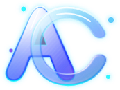
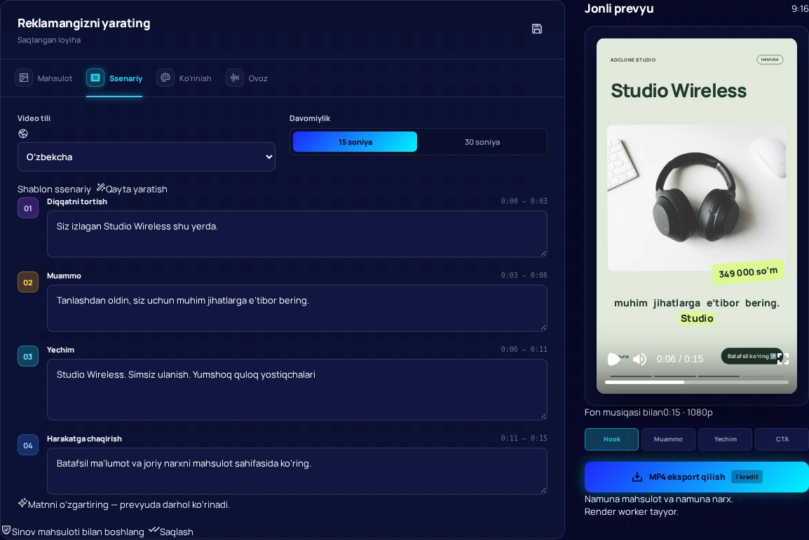
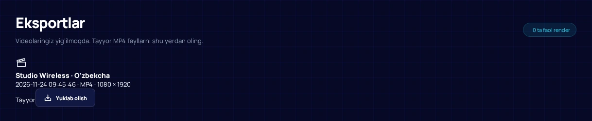
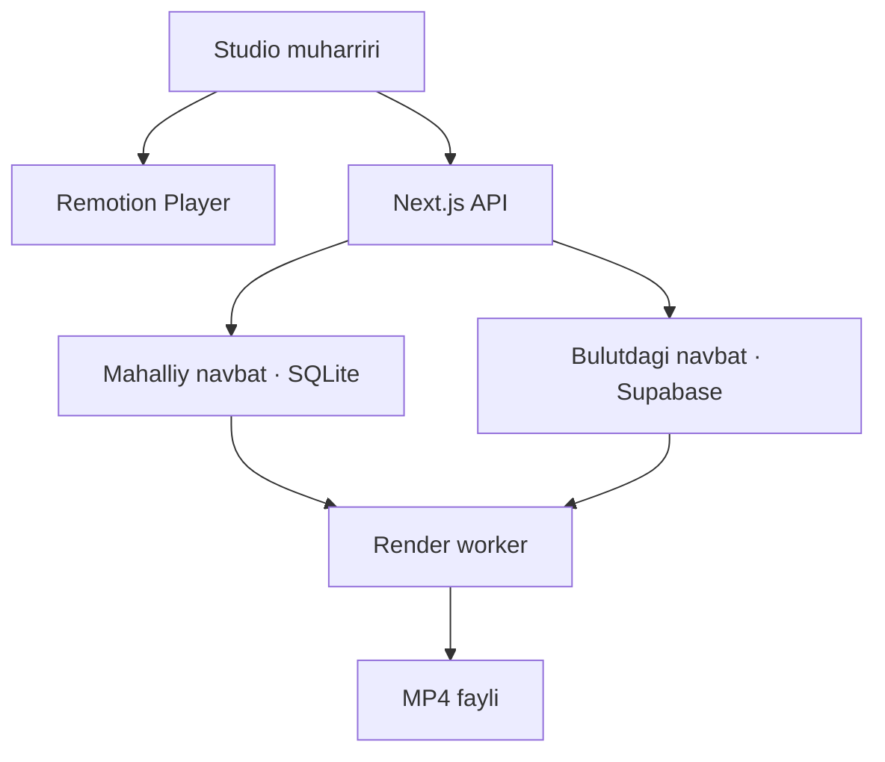

# AdClone Studio



AdClone Studio onlayn sotuvchiga mahsulot rasmi, narxi va xususiyatlaridan vertikal reklama videosi tayyorlashga yordam beradi. Mahsulotni havoladan oling yoki qo‘lda kiriting, to‘rtta sahna matnini tahrirlang va natijani MP4 fayl qilib yuklab oling. Muharrir o‘zbekcha, video ssenariysini esa besh tilda tayyorlash mumkin.

**Mahalliy demo API kalitlarisiz ishlaydi.** Quyidagi suratda namuna sifatida berilgan *Studio Wireless* quloqchinining ssenariysi va 9:16 formatdagi jonli prevyusi ko‘rsatilgan.



[Tez boshlash](#tez-boshlash) · [Birinchi videoni yaratish](#qanday-foydalaniladi) · [Imkoniyatlar](#imkoniyatlar-va-holat) · [Arxitektura](#arxitektura) · [Deploy](#production-deploy)

## Tez boshlash

Git, npm va **Node.js 24 LTS** o‘rnating. Node.js 22 ishlatsangiz, **22.19.0** yoki yangirog‘ini tanlang. Ilovaning `package.json` faylida 22.13.0 ko‘rsatilgan, lekin qulflangan `undici` paketi kamida 22.19.0 talab qiladi. [Paket versiyalari](adclone-studio/package-lock.json)

```sh
git clone https://github.com/ShoxruxErkinov/adclone-studio.git
cd adclone-studio/adclone-studio
npm ci
npm run dev
```

Brauzerda [mahalliy studiyani oching](http://127.0.0.1:3000). `npm run dev` veb-serverni va MP4 tayyorlaydigan render worker’ni birga ishga tushiradi. Prevyu ostida **Render worker tayyor.** yozuvi ko‘ringach, eksportni sinab ko‘rishingiz mumkin. Terminalni ochiq qoldiring.

Kalitsiz demo uchun `.env.local` ixtiyoriy. Maxsus brauzer yo‘li yoki tashqi xizmat kalitlari kerak bo‘lsa, ilova papkasida `cp .env.example .env.local` buyrug‘ini bajaring (PowerShell’da `Copy-Item .env.example .env.local`). Qiymatlarni kiritgach, server va worker’ni qayta ishga tushiring. MP4 uchun worker Chrome, Edge yoki Chromium’dan foydalanadi. Brauzer topilmasa, `CHROME_EXECUTABLE` ga uning bajariladigan fayli yo‘lini yozing. [Muhit sozlamalari](adclone-studio/.env.example)

## Qanday foydalaniladi

Quyidagi misolni mahsulot havolasi yoki tashqi xizmat hisobisiz takrorlash mumkin.

1. **Mahsulot.** Studiyada *Studio Wireless* namuna mahsuloti tayyor turadi. O‘z mahsulotingiz uchun **Mahsulot** bo‘limida nom, narx, tavsif va xususiyatlarni kiriting. **Rasm yuklash** JPG, PNG va WebP fayllarini 3.5 MB gacha qabul qiladi. HTTPS havola bilan ishlasangiz, **Mahsulotni olish** tugmasini bosing va import qilingan ma’lumotlarni tekshiring.
2. **Ssenariy.** Mahsulot ma’lumotlarini almashtirgach, **Ssenariy yaratish** tugmasini bosing. **Ssenariy** bo‘limida video tilini va 15 yoki 30 soniyani tanlang. Diqqatni tortish, muammo, yechim va harakatga chaqirish sahnalarining matnini tahrirlang.
3. **Ko‘rinish va ovoz.** Namunadagi ko‘rinishni takrorlash uchun **Ko‘rinish → Tabiiy** uslubini tanlang. **Ovoz → Fon musiqasi** ni yoqing. Prevyu ostidagi **Yechim** tugmasi bilan shu sahnaga o‘ting. Musiqa va subtitr uchun AI ovozini ulash shart emas.
4. **Saqlash va eksport.** **Saqlash** loyihani keyin **Loyihalarim** bo‘limidan ochish imkonini beradi. **MP4 eksport qilish** tugmasini bosing. **Eksportlar** bo‘limida holat *Navbatda → Yig‘ilmoqda → Tayyor* tarzida o‘zgaradi. **Yuklab olish** tugmasi yakuniy videoni beradi.

Mahalliy demo 10 ta test krediti bilan boshlanadi. Har bir eksport 1 kredit sarflaydi, render xatosida kredit qaytariladi. Namuna mahsulotining narxi va tavsifi namoyish uchun kiritilgan.



Namunadagi eksport 15 soniyalik vertikal video bo‘lib, o‘zbekcha subtitrlar va fon musiqasini o‘z ichiga oladi. [Studio Wireless · MP4, 1.9 MiB](docs/media/studio-wireless.mp4)

## Imkoniyatlar va holat

| Imkoniyat | Qanday ishlaydi |
| --- | --- |
| Mahsulot importi | HTTPS sahifadan Product JSON-LD yoki OpenGraph ma’lumotlarini o‘qiydi. Do‘kon avtomatik o‘qishni cheklasa, rasm va faktlarni qo‘lda kiritish mumkin. |
| Ssenariy | O‘zbek, rus, ingliz, qozoq va turk tillarida to‘rt sahnali shablonlar bor. Gemini ulanganda mahsulot faktlaridan AI ssenariysi yaratish mumkin. |
| Muharrir | Lavanda, Tabiiy va Tungi uslublari, dinamik subtitrlar, urg‘u rangi va fon musiqasi mavjud. Prevyu va eksport bitta Remotion kompozitsiyasidan foydalanadi. |
| MP4 | Worker 1080 × 1920 o‘lchamda, 30 kadr/soniya tezlikda H.264 video tayyorlaydi. Boshlang‘ich davomiylik 15 yoki 30 soniya. Ovozli matn uzunroq bo‘lsa, video ham uzayadi. |
| Loyihalar va fayllar | Mahalliy rejimda SQLite loyihalar, kreditlar va navbatni saqlaydi. Media va eksportlar ilova papkasidagi `.data/assets/` ichida turadi. |
| Ixtiyoriy xizmatlar | ElevenLabs ovoz va subtitr uchun so‘z vaqtlarini beradi. Firecrawl dinamik sahifalarni import qilishga, remove.bg rasm fonini olib tashlashga yordam beradi. Har bir xizmat alohida kalit va jonli sinov talab qiladi. |
| Rejada | Pullik obuna, to‘lov qabul qilish va mahsulotni qo‘lda ushlab ko‘rsatadigan AI avatarlar yo‘l xaritasiga kiritilgan. |

## Arxitektura

Next.js 16 va React 19 muharrirni ko‘rsatadi. Brauzerdagi Remotion Player va alohida Node.js worker bir xil Remotion 4 kompozitsiyasi — `AdComposition` — yordamida kadrlarni chizadi. Eksport tugmasi bosilganda API loyiha nusxasini navbatga qo‘yadi. Worker shu nusxadan MP4 yaratadi.



| Repozitoriydagi manzil | Vazifasi |
| --- | --- |
| [Studio.tsx](adclone-studio/src/components/Studio.tsx) | Mahsulot shakli, ssenariy, jonli prevyu va eksport boshqaruvi |
| [src/app/api/](adclone-studio/src/app/api/) | Mahsulot, loyiha, yuklangan fayl va eksport so‘rovlarini qabul qilish |
| [model.ts](adclone-studio/src/lib/model.ts) · [providers.ts](adclone-studio/src/lib/providers.ts) | Namuna mahsuloti, tillar, shablonlar va tashqi xizmatlar |
| [AdComposition.tsx](adclone-studio/src/video/AdComposition.tsx) · [worker.ts](adclone-studio/scripts/worker.ts) | Sahna, subtitr, audio va yakuniy render |
| [db.ts](adclone-studio/src/lib/db.ts) · [Supabase migratsiyasi](adclone-studio/supabase/migrations/001_studio.sql) | Mahalliy SQLite bazasi va bulut rejimi uchun PostgreSQL sxemasi |
| [Texnik qo‘llanma](adclone-studio/README.md) · [mahsulot tavsifi](adclone-studio/PRODUCT.md) · [dizayn](adclone-studio/DESIGN.md) | Ishga tushirish, mahsulot maqsadi va interfeys qarorlari |
| [Biznes-reja](<AdClone_Studio_Biznes_Reja(1).docx>) | Auditoriya, tijorat paketlari va moliyaviy prognozlar uchun rejalashtirish hujjati |

## Test va sifat nazorati

Buyruqlarni `package.json` joylashgan ichki `adclone-studio/` papkasida bajaring.

```sh
npm run typecheck
npm test
npm run build
```

Testlar import, rasm formati, besh tildagi ssenariylar, subtitr vaqtlari, kreditni qaytarish hamda Supabase migratsiyasidagi foydalanuvchi huquqlarini tekshiradi. [Test fayllari](adclone-studio/tests/)

## Production deploy

Bulut uchun repozitoriyda Vercel, Supabase va alohida render worker konfiguratsiyasi bor. Vercel’da **Root Directory** qiymati `adclone-studio` bo‘ladi. Supabase Auth, PostgreSQL va private Storage uchun migratsiyani qo‘llang. Worker’ni Chromium ishlata oladigan doimiy serverda ishga tushiring. `SUPABASE_SERVICE_ROLE_KEY` faqat worker muhitida saqlanadi.

Ommaviy namoyishdan oldin staging’da ikki hisob bilan kirish, fayllarga ruxsat va MP4 yuklab olishni sinab ko‘ring. Docker buyrug‘i, muhit o‘zgaruvchilari va tekshiruv tartibi [deploy qo‘llanmasida](adclone-studio/README.md#vercel--supabase-deploy) berilgan.

## Muammolar va yechimlar

| Alomat | Nima qilish kerak |
| --- | --- |
| npm `package.json` faylini topa olmayapti | Repozitoriy ildizidan `cd adclone-studio` ni bajaring. `node -v` bilan Node.js versiyasini tekshiring. |
| Prevyu ishlaydi, eksport boshlanmayapti | **Sozlamalar → Render worker** holatini tekshiring. Server `npm run dev:web` bilan ishga tushirilgan bo‘lsa, ikkinchi terminalda ilova papkasidan `npm run worker` ni bajaring. |
| Render xato bilan tugadi | Worker terminalidagi xabarni tekshiring. Brauzer topilmagan bo‘lsa, `CHROME_EXECUTABLE` ni sozlang va worker’ni qayta ishga tushiring. |
| Import natijasi bo‘sh yoki noto‘liq | **Qo‘lda kiriting** orqali rasm va mahsulot faktlarini to‘ldiring. |
| Mahalliy sinovni yangi baza bilan boshlash kerak | Server va worker’ni to‘xtating. Ilova papkasidagi `.data/` ni zaxira nomiga ko‘chiring. Keyingi ishga tushishda yangi baza yaratiladi, avvalgi fayllar zaxirada qoladi. |

## Hissa qo‘shish va litsenziya

Kod o‘zgarishlarini alohida tarmoqda tayyorlab, yuqoridagi uchta tekshiruvni bajaring va pull request oching. Maxfiy kalitlarni `.env.local` da saqlang. Namuna media manbalari texnik qo‘llanmada keltirilgan. Repozitoriyda loyiha kodi uchun alohida `LICENSE` fayli yo‘q. [Media manbalari](adclone-studio/README.md#assets) · [Remotion litsenziyasi](https://www.remotion.dev/license)

Xatolar va takliflar uchun [GitHub Issues](https://github.com/ShoxruxErkinov/adclone-studio/issues) oching.
