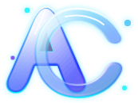
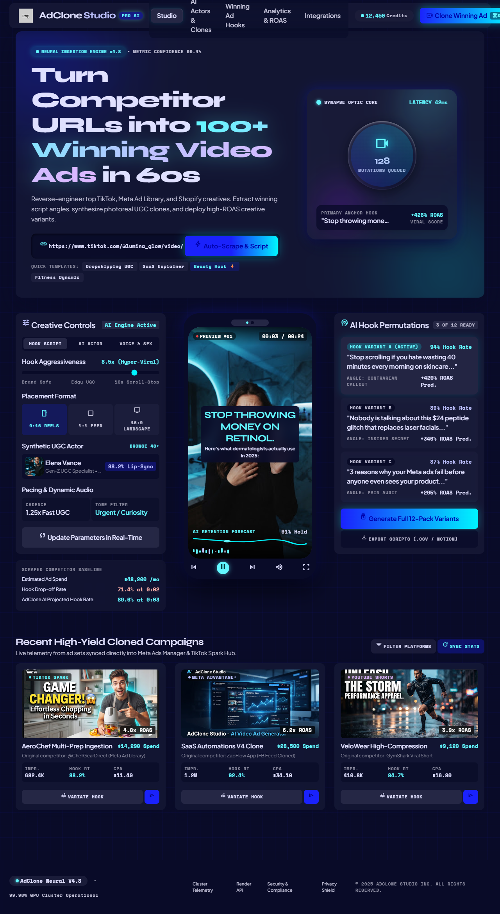

# AdClone Studio

**Mahsulot havolasidan tayyor reklama videosigacha.**

Mahsulotni import qiling, ssenariy yozing yoki yarating, videoni jonli muharrirda sozlang va vertikal MP4 sifatida eksport qiling.

**O‘zbekcha interfeys · 5 til · Next.js + Remotion · Mahalliy MVP**

[Tez boshlash](#tez-boshlash) · [Imkoniyatlar](#imkoniyatlar-va-holat) · [Foydalanish](#qanday-foydalaniladi) · [Deploy](#production-deploy) · [Texnik hujjat](adclone-studio/README.md)

---

> **Loyiha holati:** bu repository — lokal ishlatish va sinash uchun tayyor **MVP**. Vercel + Supabase va alohida render worker uchun kod/migratsiyalar mavjud, ammo ularni haqiqiy hisoblar bilan sozlash va staging’da tekshirish kerak. Bu README loyihani ommaviy production servis yoki pullik SaaS sifatida ishga tushgan deb da’vo qilmaydi.

## Loyiha haqida

**AdClone Studio** — onlayn sotuvchilar, kontent yaratuvchilar va kichik bizneslar uchun mahsulot asosidagi qisqa reklama videosini tayyorlash studiyasi. Odatdagi ish jarayoni:

**Mahsulot URL / rasm → Mahsulot ma’lumotlari → 4 qismli ssenariy → Video muharriri → MP4 eksport.**

Loyiha ayniqsa o‘zbek tilida ishlaydigan foydalanuvchilar uchun ishlab chiqilgan. Demo muharriri va oddiy ssenariy shablonlari **AI API kalitlarisiz** ishlaydi. Qo‘shimcha provayderlar ulansa, AI ssenariy, sintez qilingan ovoz, sahifa scraping va rasm fonini olib tashlash funksiyalaridan foydalanish mumkin.

## Imkoniyatlar va holat

| Funksiya | Holat | Izoh |
| --- | --- | --- |
| Namuna mahsulot bilan demo | ✅ Mavjud | Tashqi API kalitisiz lokal sinov |
| Mahsulot rasmi va ma’lumotlarini kiritish | ✅ Mavjud | Nom, narx, tavsif, xususiyatlar |
| HTTPS mahsulot URL importi | ✅ Cheklovlar bilan | JSON-LD/OpenGraph; ayrim marketplace sahifalari bloklashi mumkin |
| 4 sahnali ssenariy | ✅ Mavjud | Diqqatni tortish → Muammo → Yechim → CTA |
| O‘zbek, rus, ingliz, qozoq, turk tillari | ✅ Mavjud | Shablon va muharrirda tanlanadi |
| Jonli video preview | ✅ Mavjud | Remotion Player |
| Uslub, subtitr, rang va musiqa | ✅ Mavjud | 3 uslub va mahalliy instrumental audio |
| 15/30 soniyalik video | ✅ Mavjud | Ovoz uzun bo‘lsa natija davomiyligi uzayishi mumkin |
| MP4 eksport | ✅ Lokal MVP | H.264, 1080 × 1920, 30 fps; ovoz bo‘lsa audio ham qo‘shiladi |
| Loyihalar va eksport tarixi | ✅ Lokal MVP | SQLite va mahalliy fayllar |
| Gemini AI ssenariysi | 🔑 Integratsiya mavjud | API kaliti va real hisobda sinov kerak |
| ElevenLabs ovozi va so‘z vaqt belgilari | 🔑 Integratsiya mavjud | API kaliti, voice ID va mos model kerak |
| Firecrawl orqali murakkab sahifa importi | 🔑 Integratsiya mavjud | API kaliti kerak |
| remove.bg bilan fonni olib tashlash | 🔑 Integratsiya mavjud | API kaliti kerak |
| Supabase Auth, PostgreSQL, private Storage | 🛠️ Kod tayyor | Cloud hisoblari, migratsiya va end-to-end sinov kerak |
| Alohida Docker render worker | 🛠️ Konfiguratsiya mavjud | Server/container’da ishga tushirilishi kerak |
| AI avatar / product-in-hand UGC | 🗓️ Rejada | Hozir ishlaydigan funksiya sifatida ko‘rsatilmaydi |
| Haqiqiy to‘lov va obuna | 🗓️ Rejada | Stripe/Payme/Click integratsiyasi yo‘q |

**Muhim:** demo’dagi mahsulot, tavsif va narxlar — haqiqiy savdo taklifi emas. Import qilingan sahifalarning to‘liq yoki xatosiz o‘qilishi kafolatlanmaydi.

## Texnologiyalar

| Qatlam | Texnologiya |
| --- | --- |
| Web ilova | Next.js 16 (App Router), React 19, TypeScript |
| Video preview / render | Remotion 4, Chromium, FFmpeg |
| Interfeys | CSS, Manrope, Lucide / Phosphor Icons |
| Validatsiya | Zod |
| HTML parsing | Cheerio |
| Lokal saqlash | Node.js SQLite, `.data/` katalogi |
| Production backend | Supabase Auth, PostgreSQL, RLS, Storage |
| Production hosting | Vercel + alohida Node/Docker worker |
| Ixtiyoriy AI xizmatlari | Gemini, ElevenLabs, Firecrawl, remove.bg |

## Tez boshlash

### Talablar

- **Node.js 24 LTS** tavsiya etiladi; `package.json` bo‘yicha kamida **22.13.0** kerak.
- **npm** (loyihada `package-lock.json` bor; takrorlanadigan o‘rnatish uchun `npm ci` ishlating).
- **Google Chrome, Microsoft Edge yoki Chromium** — MP4 render uchun. Ayrim tizimlarda Remotion brauzerni o‘zi yuklashi mumkin.
- Git va lokal video eksport uchun yetarli disk xotirasi.

### 1. Repository’ni klonlash

~~~bash
git clone https://github.com/ShoxruxErkinov/adclone-studio.git
cd adclone-studio/adclone-studio
~~~

> **Eslatma:** kod repository ichidagi ikkinchi `adclone-studio/` katalogida joylashgan. GitHub repository xususiy bo‘lsa, klonlash uchun ruxsatingiz bo‘lishi kerak.

### 2. Paketlarni o‘rnatish

~~~bash
npm ci
~~~

### 3. Muhit faylini tayyorlash

**macOS / Linux:**

~~~bash
cp .env.example .env.local
~~~

**Windows PowerShell:**

~~~powershell
Copy-Item .env.example .env.local
~~~

Lokal demo uchun API kalitlari kiritilishi **shart emas**. `.env.local` faylidagi `APP_URL=http://127.0.0.1:3000` qiymatini qoldirishingiz mumkin.

### 4. Ilovani ishga tushirish

~~~bash
npm run dev
~~~

Brauzerda oching:

**http://127.0.0.1:3000**

`npm run dev` bir vaqtning o‘zida Next.js web serverini **va** lokal render worker’ni ishga tushiradi. Terminalni yopmang. To‘xtatish uchun `Ctrl+C` bosing.

### 5. Birinchi videoni sinab ko‘rish

1. Namuna mahsulotni tanlang yoki o‘zingizning rasmingiz va mahsulot ma’lumotlarini kiriting.
2. Til va **15 yoki 30 soniya** davomiylikni tanlang.
3. Ssenariyning **Hook / Muammo / Yechim / CTA** qismlarini tahrirlang.
4. Uslub, subtitr, urg‘u rangini va musiqani sozlang.
5. Preview’ni ko‘rib, loyihani saqlang va **MP4 eksport** qiling.
6. Eksport holatini kuzating va tayyor faylni yuklab oling.

Mahalliy baza dastlab **10 ta test krediti** bilan yaratiladi. Ular haqiqiy pul yoki sotib olingan kredit emas.

## Qanday foydalaniladi

### Mahsulotni qo‘shish

Mahsulotni demo’dan olish, qo‘lda kiritish, rasm yuklash yoki HTTPS havoladan import qilish mumkin. URL importi sahifadagi Product JSON-LD va OpenGraph ma’lumotlarini qidiradi. Dinamik yoki himoyalangan marketplace sahifalariga kirishda cheklovlar uchrashi mumkin — bunday holatda mahsulotni qo‘lda to‘ldiring.

### Ssenariy va tillar

Muharrir to‘rtta izchil sahnadan foydalanadi:

| Bosqich | Vazifa |
| --- | --- |
| **Hook** | Tomoshabin e’tiborini tortish |
| **Problem** | Xaridor ehtiyojiga e’tibor qaratish |
| **Solution** | Mahsulotning berilgan faktlarga asoslangan afzalliklari |
| **CTA** | Keyingi harakatga chaqirish |

Tillar: **O‘zbekcha (uz), Русский (ru), English (en), Қазақша (kk), Türkçe (tr)**. Gemini sozlanmasa, shablon ssenariy ishlaydi; sozlansa AI ssenariy so‘ralishi mumkin. Faktlar, narxlar va da’volarni eksportdan oldin foydalanuvchi tekshirishi kerak.

### Video va audio

Preview va MP4 eksport **bitta `AdComposition`** komponentidan foydalanadi. Subtitr, ranglar, sahnalar, 3 ta vizual uslub va mahalliy instrumental audio mavjud. ElevenLabs ulansa ovoz generatsiyasi hamda so‘zlar bo‘yicha vaqt belgilari ishlatiladi; provider mosligi haqiqiy hisobda tekshirilishi zarur.

## npm buyruqlari

Barcha buyruqlar **ichki `adclone-studio/` katalogidan** ishga tushiriladi.

| Buyruq | Vazifasi |
| --- | --- |
| `npm run dev` | Lokal web server + render worker |
| `npm run dev:web` | Faqat Next.js development server |
| `npm run worker` | Alohida render worker |
| `npm run typecheck` | TypeScript xatolarini tekshirish |
| `npm test` | Avtomatlashtirilgan testlarni ishga tushirish |
| `npm run build` | Next.js production build |
| `npm run start` | Lokal production-mode web server + worker |

## Muhit o‘zgaruvchilari

To‘liq namuna: [`adclone-studio/.env.example`](adclone-studio/.env.example).

| O‘zgaruvchi | Kerak bo‘ladigan holat | Izoh |
| --- | --- | --- |
| `APP_URL` | Cloud deploy | Ilova HTTPS origin’i; lokalda `http://127.0.0.1:3000` |
| `NEXT_PUBLIC_SUPABASE_URL` | Supabase rejimi | Supabase Project URL |
| `NEXT_PUBLIC_SUPABASE_ANON_KEY` | Supabase rejimi | Brauzer uchun public/anon kalit; RLS bilan ishlaydi |
| `SUPABASE_SERVICE_ROLE_KEY` | **Faqat worker** | Maxfiy kalit; frontend va Vercel web env’iga qo‘ymang |
| `GEMINI_API_KEY` | Ixtiyoriy | AI ssenariy |
| `GEMINI_MODEL` | Ixtiyoriy | Namuna: `gemini-2.5-flash` |
| `ELEVENLABS_API_KEY` | Ixtiyoriy | AI ovoz |
| `ELEVENLABS_VOICE_ID` | Ixtiyoriy | Tanlangan ovoz |
| `ELEVENLABS_MODEL_ID` | Ixtiyoriy | Maqsadli tilni qo‘llaydigan model |
| `FIRECRAWL_API_KEY` | Ixtiyoriy | Sahifa scraping |
| `REMOVE_BG_API_KEY` | Ixtiyoriy | Rasm fonini olib tashlash |
| `CHROME_EXECUTABLE` | Zarur bo‘lishi mumkin | Chromium/Chrome/Edge executable yo‘li |
| `RENDER_CONCURRENCY` | Ixtiyoriy | Render parallelizmi |
| `PORT` | Ixtiyoriy | Lokal port; standart `3000` |
| `ALLOW_LOCAL_DEMO` | Lokal smoke test uchun | **Production’da yoqmang** |

**Xavfsizlik:** `.env.local` va boshqa maxfiy fayllarni Git’ga commit qilmang. `NEXT_PUBLIC_` prefiksi bor o‘zgaruvchilar brauzer kodiga chiqishi mumkin; maxfiy tokenlar uchun ishlatmang.

## Arxitektura

~~~mermaid
flowchart TD
    A["Brauzer / Studio UI"] --> B["Next.js API"]
    B --> C["Mahsulot importi / ssenariy / media"]
    C --> D["Remotion Player — preview"]
    B --> E{"Ishlash muhiti"}
    E -->|Lokal demo| F["SQLite + .data/assets"]
    E -->|Cloud| G["Supabase Auth / Postgres / Storage"]
    F --> H["Lokal render worker"]
    G --> I["Alohida Docker / Node worker"]
    H --> J["Remotion + Chromium / FFmpeg"]
    I --> J
    J --> K["MP4 eksport"]
~~~

Lokal demo ma’lumotlari `adclone-studio/.data/` ichida saqlanadi: `studio.sqlite` loyihalar, navbat va test kreditlari uchun; `assets/` media va tayyor videolar uchun. Katalog Git’dan chiqarilgan. Bu lokal rejimni umumiy, ko‘p foydalanuvchili public servis sifatida ishlatmang.

### Repository tuzilmasi

~~~text
adclone-studio/                  # GitHub repository ildizi
├── README.md                    # Siz o‘qiyotgan hujjat
└── adclone-studio/              # Asosiy Next.js ilova
    ├── README.md                # Texnik/deploy yo‘riqnoma
    ├── .env.example             # Muhit o‘zgaruvchilari namunasi
    ├── package.json
    ├── vercel.json
    ├── Dockerfile.worker
    ├── compose.worker.yml
    ├── public/                  # Logo, demo foto, media, fontlar
    ├── src/
    │   ├── app/                # Sahifalar va API route'lar
    │   ├── components/         # Studio interfeysi
    │   ├── lib/                # Model, provider, saqlash, xavfsizlik
    │   └── video/              # Remotion composition
    ├── scripts/                 # Dev va render worker
    ├── supabase/migrations/     # SQL migratsiyalar
    └── tests/                   # Avtomatik tekshiruvlar
~~~

## Production deploy

> Production’ga chiqish uchun Supabase loyihasi, domen/HTTPS, worker hosting, xavfsiz secret boshqaruvi va haqiqiy sinovlar talab etiladi. **Faqat Vercel’ga deploy qilish MP4 render tizimini to‘liq ishga tushirmaydi.**

1. **Supabase**: loyiha yarating, `supabase/migrations/001_studio.sql` ni staging’da tekshirib qo‘llang; Auth URL/redirect, email confirmation, SMTP va RLS ni sozlang.
2. **Vercel**: GitHub repository’ni import qiling. **Root Directory = `adclone-studio`**, Framework = Next.js, Node = **24.x**. Kerakli public env va server-side provider secret’larini kiriting.
3. **Worker**: Node.js/Chromium ishlaydigan VPS, Render yoki Railway container’ida alohida render jarayonini ishga tushiring. Worker’da Supabase URL va **`SUPABASE_SERVICE_ROLE_KEY`** bo‘lishi kerak.
4. **Tekshirish**: kamida ikki hisob bilan Auth, private fayllar, loyiha ajratilishi, kredit rezerv/refund va real MP4 eksportni staging’da tekshiring. Monitoring, backup va retention siyosatini qo‘shing.

Docker worker misoli (ichki katalogda, mos `.env.local` bilan):

~~~bash
docker compose -f compose.worker.yml up --build -d
~~~

Worker loglari:

~~~bash
docker compose -f compose.worker.yml logs -f
~~~

Batafsil deploy, SQL/RLS, resurs cheklovlari va xavfsizlik modeli: **[Ilovaning texnik README’si](adclone-studio/README.md#vercel--supabase-deploy)**.

## Test va sifat nazorati

~~~bash
cd adclone-studio
npm run typecheck
npm test
npm run build
~~~

> Buyruqlarni repository ildizidan bajarayotgan bo‘lsangiz, yuqoridagi `cd adclone-studio` kerak. Agar allaqachon ichki katalogda bo‘lsangiz, uni takrorlamang.

Testlarda mahsulot sahifalarini parsing qilish, zararli URL/SSRF chegaralari, sxema validatsiyasi, subtitr/til vaqtlari, lokal kredit tranzaksiyalari va Supabase migratsiyasining ayrim xavfsizlik jihatlari qamrab olingan. **Lokal testdan o‘tish — real Auth, SMTP, Storage yoki pullik AI provayderlar cloud muhitida sinovdan o‘tganini anglatmaydi.**

## Muammolar va yechimlar

<strong>`npm ci` yoki `npm run dev` ishlamayapti</strong>

Node va npm versiyasini `node -v` / `npm -v` bilan tekshiring; Node 24 LTS tavsiya etiladi. Buyruqlarni `package.json` mavjud bo‘lgan ichki `adclone-studio/` katalogidan ishga tushiring. Windows’da npm PATH muammosi bo‘lsa, o‘rnatilgan `npm.cmd` manzilidan foydalaning.

<strong>Render worker ulanmagan / eksport boshlanmayapti</strong>

`npm run dev` ikkala jarayonni ochganini tekshiring. `npm run dev:web` faqat web serverni ishga tushiradi — bunday holatda alohida `npm run worker` kerak. Production’da Vercel’dan tashqarida worker ishlashi va Supabase bilan ulanishi shart.

<strong>Chromium yoki MP4 render xatosi</strong>

Chrome/Edge/Chromium o‘rnatilganini tekshiring. Zarur bo‘lsa, `CHROME_EXECUTABLE` qiymatini executable’ning to‘liq yo‘liga belgilang; serverdagi xotira va disk bo‘shligini tekshiring.

<strong>Uzum, Wildberries yoki boshqa URL import bo‘lmayapti</strong>

Sahifa scraping’ni cheklashi, JavaScript bilan to‘ldirilishi yoki Product JSON-LD/OpenGraph ma’lumotini bermasligi mumkin. Mahsulot rasmi va ma’lumotlarini qo‘lda kiriting. Firecrawl integratsiyasi yordam berishi mumkin, ammo natija kafolatlanmaydi.

<strong>AI ssenariy, AI ovoz yoki fonni o‘chirish ishlamayapti</strong>

Kerakli provider kaliti va hisob imkoniyatlarini tekshiring. ElevenLabs uchun API kalitidan tashqari voice ID hamda tilni qo‘llaydigan model kerak. Kalitsiz rejimda oddiy ssenariy shablonidan foydalaning.

<strong>Lokal test ma’lumotlarini noldan boshlash kerak</strong>

Web server va worker’ni to‘xtating. Muhim fayllarni zaxiralagandan **keyin** ichki `adclone-studio/.data/` katalogini o‘chirish lokal loyihalar, eksportlar, media va test kreditlar tarixini ham butunlay o‘chiradi. Keyingi ishga tushishda yangi lokal SQLite baza yaratiladi. Bu production ma’lumotlariga taalluqli emas.

## Xavfsizlik va cheklovlar

- URL importi tashqi manzillarga murojaat qiladi: ilovada HTTPS, ichki IP/SSRF, redirect, hajm va timeout tekshiruvlari mavjud; production’da doimiy xavfsizlik auditi ham zarur.
- Supabase rejimida foydalanuvchi ma’lumotlarini ajratish uchun RLS va private Storage ko‘zda tutilgan; sozlamalar va haqiqiy huquqlar staging’da tasdiqlanishi kerak.
- `SUPABASE_SERVICE_ROLE_KEY` hech qachon browser, public environment yoki repository tarixiga chiqarilmasligi kerak.
- Demo krediti real to‘lov tizimi emas. Pullik provider kalitlari bilan ishlaganda xarajatlar sizning provider hisoblaringizga bog‘liq.
- Uchinchi tomon saytlari, media, ovozlar va mahsulot kontentidan foydalanish huquqlarini tekshiring.
- Remotion’dan tijoriy foydalanishda [rasmiy litsenziya shartlarini](https://www.remotion.dev/license) alohida tekshiring.

## Yo‘l xaritasi

Quyidagilar **rejalashtirilgan**, hozir tayyor funksiya deb hisoblanmaydi:

- [ ] Haqiqiy cloud deploy va end-to-end staging testlari
- [ ] Provider’lar bilan jonli sifat, tezlik va xarajat sinovlari
- [ ] Rozilik asosidagi AI avatar / product-in-hand UGC
- [ ] Stripe, Payme yoki Click orqali haqiqiy billing va webhook’lar
- [ ] Production monitoring, backup, retention, rate-limit va support jarayonlari
- [ ] E2E browser testlarni CI’da avtomatlashtirish

## Hissa qo‘shish va aloqa

Repo’ga kirish ruxsati borlar xatolarni GitHub Issues orqali bildirishlari va o‘zgarishlarni alohida branch + pull request shaklida taklif qilishlari mumkin. Kod o‘zgartirishdan oldin `npm run typecheck`, `npm test` va `npm run build` ni bajaring.

**Muallif / repository:** [ShoxruxErkinov](https://github.com/ShoxruxErkinov) · [adclone-studio](https://github.com/ShoxruxErkinov/adclone-studio)

**Texnik tafsilotlar:** [adclone-studio/README.md](adclone-studio/README.md) · [PRODUCT.md](adclone-studio/PRODUCT.md) · [DESIGN.md](adclone-studio/DESIGN.md)

**Litsenziya eslatmasi:** repository’da alohida `LICENSE` fayli ko‘rinmaydi; bu koddan istalgan sharoitda foydalanishga avtomatik ruxsat berilganini anglatmaydi. Muallif litsenziyani alohida belgilashi mumkin.

---

**AdClone Studio — mahsulotingiz, yangi hikoya.**

